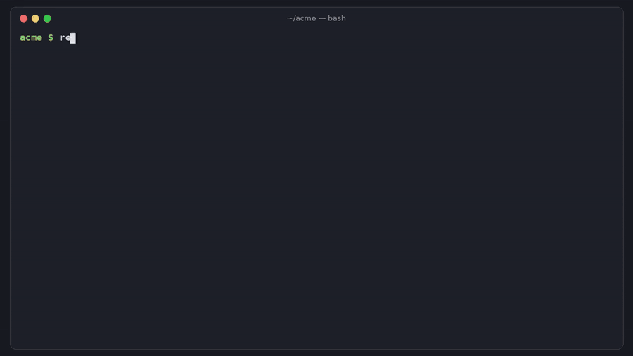

# restoredrill

[](https://github.com/hamarshehmhmd/restoredrill/actions/workflows/ci.yml)
[](LICENSE)


**Prove your Postgres backups actually restore.** restoredrill takes your newest `pg_dump` file, restores it into a throwaway Postgres server, runs your checks (row counts, freshness, your own SQL), and fails loudly when the backup wouldn't come back. Run it from cron or as a GitHub Action every night.



```sh
curl -fsSL https://raw.githubusercontent.com/hamarshehmhmd/restoredrill/main/install.sh | sh
```

## Why

Everyone has backups. Almost nobody restores them until the day they have to:

- [Backups Aren't Simple](https://news.ycombinator.com/item?id=49732513) and [An AI agent deleted our production database](https://news.ycombinator.com/item?id=47911524) on Hacker News
- [supabase/supabase#40625](https://github.com/supabase/supabase/issues/40625): a logical backup made with pg_dump 17.6+ contains commands Postgres 15.8 can't run
- [coollabsio/coolify#9860](https://github.com/coollabsio/coolify/issues/9860): "Unable to import Coolify created backup"

The ways a backup goes bad are boring and silent: the cron job ran out of disk halfway, the dump needs a role or extension the new server doesn't have, it was written by a newer `pg_dump` than the target, or the job simply stopped running three weeks ago. A file existing with a plausible size tells you none of that. The only real test is a restore.

## What it checks

| check | catches |
|---|---|
| restore ran without errors | missing roles, extensions, version-specific SQL, corrupt archives (each error gets a fix hint) |
| backup is complete | plain/`.sql.gz` dumps cut off mid-stream (no `-- PostgreSQL database dump complete` footer, broken gzip) |
| all tables in the dump were restored | tables listed in the archive that never showed up |
| compatible with target | dump from a newer major than the target, `pg_restore` too old for the archive, `transaction_timeout` (PG17+), `\restrict` (psql 17.6 / 16.10 / 15.14 / 14.19 / 13.22+) |
| freshness / size / shrink | backup older than `max_age_hours`, smaller than `min_size`, or size/rows dropped more than `max_shrink_pct` vs the last passing run |
| `expect_tables`, `[[check]]` | your own row counts and SQL smoke queries (`min`, `max`, `equals`) |

Formats: custom (`-Fc`), directory (`-Fd`), tar (`-Ft`), plain SQL and gzipped plain SQL. `pg_dumpall` output works too (set `database = "yourdb"` to get row counts and checks for one of its databases).

## Usage

```sh
restoredrill inspect backups/shop.dump                 # read the header: versions, tables, extensions, roles. No restore.
restoredrill run backups/*.dump                        # restore the newest match and check it
restoredrill run backups/*.dump --role app --max-age 26 --expect-table public.orders:1000
restoredrill run --target-version 15                   # will this dump load into Postgres 15?
restoredrill init > restoredrill.toml                  # starter config
restoredrill run                                       # uses ./restoredrill.toml
restoredrill doctor                                    # which Postgres binaries / Docker it can use
```

Exit codes: `0` all checks passed, `1` the backup is bad, `2` restoredrill could not run (no server available, bad config).

Output: colored text by default, `--format json|markdown|junit`, `--junit file.xml`, and a Markdown summary is written to `$GITHUB_STEP_SUMMARY` automatically in GitHub Actions.

### Where it restores

`--engine auto` (default) picks, in order: local Postgres binaries of the dump's major version, then Docker `postgres:<major>`, then newer local binaries. Local servers are created with `initdb` in a temp dir, listen only on a private Unix socket, and are deleted afterwards. It looks for binaries in `RESTOREDRILL_PG_BIN` / `--pg-bin`, `PATH`, `/usr/lib/postgresql/*/bin`, Homebrew and Postgres.app. Nothing ever connects to your production database.

### Config

```toml
backup = "backups/*.dump"        # path or glob; newest match wins
# fetch = "aws s3 cp s3://my-bucket/db/latest.dump {out}"   # or download it first
max_age_hours = 26
min_size = "500KB"
max_shrink_pct = 50              # vs .restoredrill-history.jsonl
roles = ["app"]                  # created before restore
# no_owner = true                # or restore with --no-owner --no-acl
# target_version = 15

expect_tables = { "public.customers" = 1000, "public.orders" = 1000 }

[[check]]
name = "newest order is < 26 h old"
sql = "select extract(epoch from now() - max(created_at)) / 3600 from orders"
max = 26
```

Paths are relative to the directory you run it from.

### GitHub Action

```yaml
on:
  schedule: [{cron: "0 6 * * *"}]
jobs:
  drill:
    runs-on: ubuntu-latest
    steps:
      - uses: actions/checkout@v4
      - run: aws s3 cp s3://my-bucket/db/latest.dump backups/latest.dump   # however you get the file
      - uses: hamarshehmhmd/restoredrill@v0.1.0
        with:
          backup: backups/*.dump
          args: --role app --max-age 26 --expect-table public.orders:1
```

On GitHub runners it uses Docker `postgres:<major>` matching your dump (or the preinstalled local Postgres if versions match). Output `status` is `pass`, `fail` or `error`.

### Cron

```sh
0 6 * * * cd /srv/backups && restoredrill run --color never || curl -fsS -d "backup drill failed on $(hostname)" https://ntfy.sh/my-alerts
```

## Install

The one-liner above installs with `uv tool`, `pipx`, or a private venv in `~/.local/share/restoredrill` (whichever you have) and links `restoredrill` into `~/.local/bin`. Or:

```sh
pipx install git+https://github.com/hamarshehmhmd/restoredrill
```

Needs Python 3.9+ and either Postgres server binaries (`initdb`, `pg_ctl`, `postgres`, `psql`, `pg_restore`; e.g. `apt install postgresql-17`, `brew install postgresql@17`) or Docker. Linux and macOS.

## Demo

[demo.mp4](https://github.com/hamarshehmhmd/restoredrill/releases/download/v0.1.0/demo.mp4) (2.5 min, narrated): a real Postgres 17 database, a backup that fails on a missing role, a config that passes 9 checks, a truncated `.sql.gz` from a job that ran out of disk, and a 17 → 15 restore that can't work. Rebuild it with `python demo/render.py`.

## Development

```sh
python -m venv .venv && .venv/bin/pip install -e . pytest
.venv/bin/pytest -q                     # integration tests run when Postgres binaries are found
RESTOREDRILL_PG_BIN=/usr/lib/postgresql/17/bin .venv/bin/pytest -q
```

## License

[GNU AGPL-3.0-or-later](LICENSE). If you want to ship restoredrill inside a product or service without the AGPL's obligations, commercial licenses are available from the author, Mohammad Hamarsheh ([@hamarshehmhmd](https://github.com/hamarshehmhmd)).
